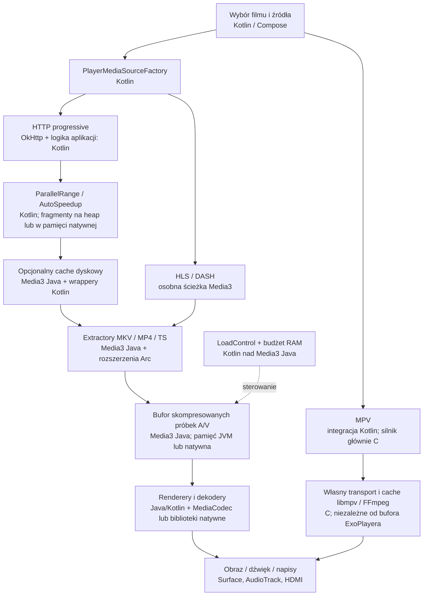

# Plan portu pobierania i buforowania HTTP do Rust

Dokument wykonawczy dla GPT Sol. Stan analizy: 16 listopada 2026 r.

Repozytorium: `tomfle18/NuvioTV-Fork`. Gałąź robocza: `rust_port`.
Baza: `main`, commit `343b27591b65ca57372c2a7d420e767a8f86260c`.
Status aktualizacji: zaimplementowany eksperymentalny transport Rust, JNI i integracja aplikacji; Kotlin pozostaje domyślny. Testy i buildy hosta są opisane w `RUST_PORT_STATUS.md`. Odbiór sprzętowy i benchmarki z etapu 6 pozostają otwarte.

## 1. Cel i granice

Zbudować osobny silnik pobierania HTTP/HTTPS i bufora surowych bajtów w Rust, zintegrowany z istniejącym odtwarzaczem Arc. Priorytety w kolejności: poprawność danych i niezawodność, brak regresji startu/przewijania, mniejszy narzut CPU i alokacji, lepsza użyteczna przepustowość.

Pierwsza wersja obejmuje progresywne pliki VOD, przede wszystkim MKV i MP4. Rust ma obsługiwać transport, zakresy, pobieranie z wyprzedzeniem, pamięć, anulowanie i odzyskiwanie po błędach. Kotlin pozostaje właścicielem interfejsu, ustawień, wyboru źródła i integracji Androida.

Zachować istniejący ExoPlayer/Media3 wraz z lokalnymi AAR, extractorami Arc, Dolby Vision, HDR, audio passthrough, FFmpeg, dav1d, libass, AFR i QMS. Bufor próbek ExoPlayera i jego alokator pozostają osobną warstwą. MPV zachowuje własny transport i cache. HLS, DASH, RTSP, pliki lokalne, sidecar subtitles oraz nieobsługiwane typy żądań korzystają z dotychczasowej ścieżki.

Streaming torrentów nie jest celem portu. Usuwanie istniejącej obsługi torrentów to ewentualna osobna zmiana, poza tym planem. Nie są potrzebne kod ani silnik torrentowy Stremio Native.

Nie zakładać, że sam Rust zwiększy transfer. Obecna implementacja już używa natywnej pamięci, puli bloków i odczytu do `ByteBuffer`. Korzyść ma wynikać z pomiarów całego przepływu, a nie z porównania języków.

## 2. Potwierdzony stan kodu i miejsca integracji

Ścieżki w tabeli są względne wobec `app/src/main/java/com/nuvio/tv/`, chyba że wskazano inaczej.

| Obszar | Kod | Obecnie | Rola w porcie |
|---|---|---|---|
| Wybór sposobu pobierania | `ui/screens/player/PlayerMediaSourceFactory.kt` | Kotlin | Główne miejsce wyboru Kotlin/Rust; zachować routing innych protokołów |
| Transport HTTP | `ui/screens/player/PlayerPlaybackNetworking.kt` | Kotlin + OkHttp/Okio | DNS, TLS, nagłówki, przekierowania, timeouty, prewarm; wymagają jawnego kontraktu zgodności |
| Równoległe Range i pamięć fragmentów | `ui/screens/player/ParallelRangeDataSource.kt` | Kotlin; opcjonalnie pamięć natywna | Główny zakres zastępowany przez Rust |
| Adaptacja | `ui/screens/player/AutoSpeedup.kt`, `AutoSpeedupPolicy.kt`, `AutoSpeedupDataSource.kt` | Kotlin | Docelowo port polityki; podczas przejścia jeden aktywny regulator |
| Pamięć zachowania serwerów | `ui/screens/player/HostSpeeds.kt`, `ExtraDownloadRefusal.kt` | Kotlin | Zachować nauczone limity i ich wygasanie; początkowo persistence w Kotlinie |
| Budżet żądań | `core/player/thumbnail/ConnectionLedger.kt` | Kotlin | Jeden wspólny arbitraż dla odtwarzania, prewarm i miniaturek |
| Start i ponowne otwarcia | `ui/screens/player/PlaybackPrewarm*.kt`, `PrefetchWindowStore` w `ParallelRangeDataSource.kt` | Kotlin | Identyfikacja źródła, przekazanie rozgrzanego połączenia/danych, head/tail |
| Cache dyskowy | `PlayerMediaSourceFactory.kt`, `VodCacheWriteSink.kt`, `BufferedReadDataSource.kt` | Kotlin + Media3 Java | Początkowo istniejący cache nad źródłem Rust, bez migracji formatu |
| Budżety pamięci | `core/player/BufferSizing.kt`, `BufferMemoryKeeper.kt`, `MemoryPressure.kt`, `BufferBudgetControl.kt`, `ui/screens/player/PlayerRuntimeControllerBufferMemory.kt` | Kotlin | Ustalają część RAM dostępną dla Rust oraz reakcję na presję pamięci |
| Kontrola bufora próbek | `core/player/BitrateAwareLoadControl.kt`, `ReadAheadReserve.kt` | Kotlin nad Media3 Java | Pozostaje; współpracuje przez budżet i telemetrię |
| Obserwowalność | `PlayerMemoryReporter.kt`, liczniki transferu, `core/util/TtffTrace` | Kotlin | Rozszerzyć o wybrany backend, pamięć Rust i powody przełączeń |
| MPV | `ui/screens/player/NuvioMpvSurfaceView.kt`, `PlayerRuntimeControllerMpv.kt` | Kotlin + natywne libmpv/FFmpeg | Osobna ścieżka, poza portem V1 |

Ważne szczegóły zastanego kodu:

- `ParallelRangeDataSource` ma ponad 3300 linii i rozbudowane testy. Nie jest prostą pętlą pobierającą bloki.
- `ParallelRangeDataSource`, `AutoSpeedupDataSource` i część wrapperów implementują rozszerzenie `ByteBufferDataReader`. Zachowanie tej ścieżki jest wymaganiem wydajnościowym.
- MP4 może uruchamiać sesję fragmentów także przy wyłączonych połączeniach równoległych. Retencja fragmentów ogranicza ponowne żądania przy odczytach z odległych części pliku.
- W `PlayerPlaybackNetworking` transport odtwarzania jest ustawiony na HTTP/1.1. HTTP/2 i HTTP/3 nie wchodzą do pierwszego portu.
- Obecny mechanizm ma współdzieloną bramkę po 429/503, wykrywanie odmowy dodatkowych połączeń oraz trwałe ograniczenia serwera, z blokadą równoległości do kilku dni.
- Obecny ledger rozpoznaje limit usługi TorBox, a nie tylko poszczególnych nazw CDN. Port nie może mnożyć limitu przez liczbę hostów.
- Cache dyskowy jest opcjonalną warstwą nad źródłem. `BufferedReadDataSource` agreguje małe odczyty przy aktywnym cache; nie implementuje `ByteBufferDataReader`.
- Build deklaruje Media3 `1.8.0`, lecz kluczowe moduły są zastępowane lokalnymi AAR. `minSdk=24`, `targetSdk=36`, NDK `29.0.14206865`. Aktywne splity APK: `arm64-v8a` i `armeabi-v7a`.
- Komentarz Gradle o lokalnym `nuvio-exoplayer-engine` nie oznacza obecności takiego modułu w `settings.gradle.kts`. W tej bazie używane są AAR. Sprawdzić ich faktyczne API i sumy plików, nie wymieniać na stock Media3.
- Istniejący skrypt `scripts/perf_baseline.py` obsługuje głównie ścieżki UI i baseline profiles. Nie jest gotowym benchmarkiem nowego transportu.
- Workflow PR buduje obecnie PR do `dev`. Sam push na `rust_port` nie zapewni wymaganych testów; należy dodać odpowiednio ograniczone CI.

## 3. Obecny przepływ i języki modułów



Bufor sieciowy zawiera fragmenty pliku, np. bajty MKV. Bufor próbek zawiera już wydzielone, nadal skompresowane próbki audio i wideo wraz z informacją o czasie odtwarzania. Zdekodowane klatki i kolejki dekodera to kolejna, oddzielna część pamięci.

Języki pozostałych istotnych elementów: `dovi_bridge.cpp` to C++, `libdovi` to biblioteka Rust udostępniająca C API, FFmpeg to głównie C, dav1d to C i asembler, libass to C. Moduł FFmpeg downmix ma warstwę Java i most natywny C/C++. Generator miniaturek ma koordynację Kotlin, most C/C++ i używa FFmpeg. MediaCodec jest API platformy Android z implementacją systemową/producenta i często sprzętowym dekoderem, nie jednym modułem aplikacji napisanym w Kotlinie.

Natywny alokator Media3 jest dostarczony w AAR. Warstwa Java i testy pokazują natywne uchwyty oraz direct buffers, ale dokładny język niewidocznej tu implementacji natywnej trzeba potwierdzić w jej źródłach. Nie opisywać wszystkich bibliotek natywnych jako C++.

## 4. Docelowa architektura

```text
Kotlin: wybór źródła, ustawienia, budżety aplikacji, stan odtwarzania
  -> RustHttpDataSource / ByteBufferDataReader
  -> mały most JNI
  -> Rust: HTTP -> planowanie Range -> magazyn bloków -> uporządkowany odczyt
  -> istniejące wrappery i opcjonalny cache dyskowy
  -> istniejący extractor -> bufor próbek -> renderer / dekoder
```

Poniższy podział był propozycją analizy. Implementacja grupuje sesje, czytniki i scheduler w `engine.rs`, ownership w `store.rs`, a regulator w `control.rs`; `jni_bridge.rs` jest jedyną warstwą dotykającą pamięci JVM:

```text
native/streaming-engine/
  Cargo.toml, Cargo.lock, rust-toolchain.toml
  src/
    lib.rs, engine.rs, session.rs, reader.rs
    http.rs, range.rs, identity.rs
    scheduler.rs, retry.rs, host_policy.rs
    buffer_pool.rs, chunk_store.rs, budget.rs
    metrics.rs, error.rs, jni_bridge.rs
  tests/                 # kontrakt, HTTP, współbieżność
  benches/               # lokalne pomiary rdzenia
  fuzz/                  # parsery i sekwencje operacji

app/src/main/java/com/nuvio/tv/core/streaming/
  RustStreamingBridge.kt
  RustHttpDataSource.kt
  StreamingBackendFactory.kt
  StreamingBudgetBridge.kt
  StreamingMetrics.kt
```

Punkt startowy: Rust stable z przypiętym toolchainem, Tokio, reqwest z rustls i jni-rs; cargo-ndk do budowania. Przypiąć kompatybilne wersje w etapie 1. Włączyć tylko potrzebne funkcje bibliotek. Używać jednego współdzielonego runtime i pul klientów rozdzielanych według polityki zaufania, zamiast runtime na każdy `DataSource`.

Na początek reqwest jest łatwiejszy do utrzymania niż własna warstwa nad hyper. Przejście na hyper ma sens tylko po pomiarze konkretnego narzutu. Nie dodawać lokalnego serwera HTTP ani dodatkowego pośrednika na VPS.

## 5. Kontrakt Kotlin / JNI / Rust

Logiczne operacje, nie gotowe sygnatury do bezrefleksyjnego skopiowania:

| Operacja | Wymagane zachowanie |
|---|---|
| `createSession(config, sourceIdentity)` | Tworzy sesję filmu z budżetem i polityką hosta; zwraca kontrolowany uchwyt |
| `openReader(session, request)` | Respektuje `DataSpec.position`, długość i nagłówki; zwraca długość odczytu, finalny URI i odpowiednie nagłówki |
| `readArray(reader, byte[], offset, length)` | Zgodność ze standardowym DataSource, obsługa częściowych odczytów |
| `readDirect(reader, ByteBuffer, position, length)` | Odczyt do direct buffer bez pośredniej dużej tablicy JVM; aktualizacja pozycji bufora dokładnie o wynik |
| `cancelReader(reader)` | Przerywa oczekujący read/open i budzi oczekujących |
| `closeReader(reader)` | Idempotentne; usuwa czytelnika, nie zwalnia pamięci nadal używanej przez innych |
| `updateLimits(session, bytes, requestGrant)` | Aktualizuje ograniczenia z Androida i wspólnego arbitra |
| `snapshotStats(session)` | Mała migawka liczników; odczytywana okresowo, np. raz na sekundę |
| `releaseSession(session)` | Kończy sesję filmu, anuluje zadania, zwalnia zasoby i granty |

`DataSource` realizuje seek przez `close/open` z nową pozycją. Osobne `nativeSeek` nie jest konieczne. Retencja sesji nie może zależeć wyłącznie od życia pojedynczego obiektu DataSource. Rozróżnić reopen/seek, przejście do innego filmu i definitywne zakończenie odtwarzania.

Szczegóły kontraktu:

- Długość zero daje `0`; dodatni odczyt czeka na dane, zwraca dodatnią liczbę, EOF albo błąd. Nie zwraca stale `0` i nie wykonuje aktywnego odpytywania.
- Pozycje i rozmiary pliku: sprawdzana arytmetyka 64-bitowa. Rozmiary pojedynczych alokacji kontrolowane przed konwersją do `usize`/`Int`, także na ARM32.
- Wynik `open`, EOF, URI po redirect, wielowartościowe nagłówki i `TransferListener` mają ustalony kontrakt. Rozdzielić bajty faktycznie pobrane z sieci od podanych extractorowi oraz pobranych z cache.
- Nie wszystkie `ByteBuffer` są direct. Sprawdzać typ, writable/read-only, capacity, limit, offset i lifetime. Bezpieczna ścieżka tablicowa pozostaje dostępna.
- Nie przechowywać wskaźnika do pamięci JVM po zakończeniu wywołania. Przy oczekiwaniu na sieć nie trzymać krytycznie przypiętej tablicy Javy. Sieć pracuje do pamięci należącej do Rust; kopiowanie do celu odbywa się po dostępności danych.
- Direct buffer usuwa pośredni bufor JVM, ale nadal zwykle wymaga kopiowania z magazynu Rust do bufora odbiorcy. Nie deklarować pełnego zero-copy.
- Uchwyty to identyfikatory z generacją, nie niekontrolowane surowe wskaźniki. `close/read/cancel` muszą być odporne na wyścigi i ponowne użycie ID.
- `Result` i jawne błędy zamiast `unwrap` w ścieżkach danych. Panic nie może przekroczyć granicy JNI; izolować ją zgodnie ze strategią kompilacji. `catch_unwind` nie odzyskuje procesu po SIGSEGV ani gwarantuje obsługi OOM.
- Operacje blokujące działają poza wątkiem UI. JNI nie robi callbacku do Kotlinu dla każdej małej porcji danych; zdarzenia otwarcia/zamknięcia żądania i zbiorcze metryki są wystarczające.

## 6. Pamięć, sesje i przewijanie

Rust zarządza buforem sieciowym, nie przydziela sobie całego limitu ustawionego dla odtwarzacza. Budżet musi uwzględniać bufor próbek, dekodery, miniaturki, pamięć JVM, własne pule i transport. Rozmiar RAM telewizora/boxa jest niezależny od parametrów VPS.

1. Wprowadzić globalny limit pamięci kontrolowanej przez Rust i limity sesji. Zliczać aktywne bloki, wolną pulę, prewarm, czytelników i dane nadal trzymane po anulowaniu. Osobno mierzyć narzut TLS/runtime oraz PSS całego procesu.
2. Oddzielić rozmiar żądania Range od jednostki alokacji. Dla dużego Range nie rezerwować całej pamięci przed pierwszym bajtem. Zmierzyć segmenty np. 64/256 KiB i 1 MiB, zamiast z góry ogłaszać najlepszy rozmiar.
3. Publikować wypełnione, niemodyfikowalne segmenty z kontrolowanym ownership. Czytelnik utrzymuje referencję podczas kopiowania; blok wraca do puli dopiero po ostatnim użytkowniku. Nie wprowadzać współdzielonego mutable Vec z pozornie bezpiecznym `Arc`.
4. Czytelnik może korzystać z opublikowanego prefiksu trwającego pobierania. Nie czeka na zakończenie całego wielomegabajtowego fragmentu.
5. Prefetch ustępuje żądaniu blokującemu odtwarzanie. Pełny budżet nie może zablokować jedynego fragmentu potrzebnego do postępu. Zapewnić rezerwę dla odczytu krytycznego i możliwość usunięcia nieużywanego prefetchu.
6. Cache jest magazynem zakresów z kilkoma kursorami, nie tylko ring buffer. Musi obsługiwać przeplatanie odczytów MP4, indeks na końcu MKV/MP4 i małe odczyty extractora.
7. Po seeku aktualizować generację danego czytelnika i priorytety. Nie unieważniać automatycznie poprawnych bloków oraz pracy potrzebnej innym czytelnikom tej samej sesji.
8. Tożsamość zawiera źródło i kontekst autoryzacji; sam host lub wyczyszczony URL nie identyfikuje pliku. Przy zmianie walidatora/rozmiaru nie mieszać bajtów dwóch wersji. Prewarm wymaga tej samej tożsamości.
9. Reakcja na presję RAM: zatrzymać daleki prefetch, ograniczyć wolną pulę, zmniejszyć równoległość, usuwać wyłącznie bloki bez aktywnych referencji. Obniżenie limitu poniżej już używanej pamięci jest zbieżnością do limitu, a nie bezpieczną natychmiastową deallokacją.
10. Jawny shutdown filmu, krótka ograniczona retencja na reopen i zerowanie zasobów na finalnym release. Limit retencji nie może zostawiać wielu filmów w RAM.

## 7. Transport i odzyskiwanie po awarii

Pierwszy transport Rust: zwykły GET HTTP/1.1, jedno połączenie, odczyt strumieniowy, pooling, TLS i poprawny Range. Dopiero potem równoległość.

| Przypadek | Oczekiwana reakcja |
|---|---|
| Poprawne `206` | Zweryfikować początek/koniec/total, deklarowaną długość i kodowanie przed publikacją danych |
| `200` mimo Range | Wyłączyć równoległość; użyć sprawdzonej ścieżki single/fallback; nie uznać początku pliku za żądany offset |
| `416` | EOF tylko zgodnie z kontraktem pozycji i znanej długości; inne przypadki to błąd zakresu |
| Nieznana długość | Tryb sekwencyjny bez planowania fikcyjnego końca pliku |
| Przerwany body | Wznowienie od brakującego, zweryfikowanego bajtu; skończony budżet prób |
| Krótszy body od zadeklarowanego | Kontrolowany błąd/ponowienie, bez cichego zaliczenia pełnego fragmentu |
| `429` / odmowa dodatkowego połączenia | Wspólna pauza i redukcja równoległości; jedna próba kontrolna, respektowanie `Retry-After` |
| `503` | Rozróżnić przeciążenie, trwały błąd i znaną politykę dostawcy; unikać równoległej lawiny retry |
| `401` / `403` / wygasły URL | Przekazać klasyfikację do istniejącego odświeżania źródła; nie powtarzać bez końca |
| Błąd DNS / timeout / brak sieci | Skończone czasy oczekiwania i przerywalne retry; zachowanie gotowego bufora, jeśli nadal ważny |
| Zmiana zasobu lub niespójny Range | Przerwać i unieważnić skażoną sesję; nie ratować wyniku łączeniem sprzecznych danych |

Ustalić łączny budżet prób pomiędzy Rust i `LoadErrorHandlingPolicy`, aby obie warstwy nie mnożyły timeoutów. Rozdzielić timeout DNS/connect, nagłówków, bezczynności body i maksymalnego oczekiwania na postęp. Retry z jitterem, anulowaniem i zegarem monotonicznym; czas HTTP-date interpretowany oddzielnie.

Przy Range wymagać zgodnego kodowania reprezentacji, zwykle `Accept-Encoding: identity`, i wyłączyć automatyczne rozpakowywanie, które zmieniałoby offsety. Kontrolować redirecty i przenoszenie nagłówków, zwłaszcza Authorization/Cookie na obcy host. Nie logować tokenów ani pełnych podpisanych URL.

TLS/DNS są bramką zgodności: zbadać `ServerTrust`, certyfikaty systemowe, istniejące wyjątki użytkownika, IPv4/IPv6 i zachowanie po zmianie sieci. Rustls nie odtwarza automatycznie polityki Androida/OkHttp. W V1 nieobsługiwane konfiguracje kierować do dotychczasowej ścieżki na etapie wyboru backendu. Nie wyłączać walidacji certyfikatów globalnie w Rust w celu osiągnięcia zgodności.

Docelowa adaptacja: start ostrożny z uwzględnieniem znanej polityki hosta, wzrost po mierzalnej korzyści, szybkie zmniejszanie po odmowach, histereza i bezczynność przy pełnym buforze. Politykę obecnego `AutoSpeedupPolicy` przenieść z testami porównawczymi, a nowe algorytmy stroić w oddzielnym etapie.

`ConnectionLedger` pozostaje jedynym arbitrem całej aplikacji podczas migracji. Każde rzeczywiste żądanie Rust musi uzyskać uwzględniony w nim slot, także probe, retry, hedge i prewarm. Most może nadawać Rust pule zarezerwowanych slotów lub obsługiwać zdarzenia per request, ale nie może tylko kopiować starego limitu i ignorować równoległych żądań Kotlinu. Redirect do innej grupy serwerów aktualizuje rezerwację. Zakończenie, błąd i anulowanie zwalniają ją dokładnie raz.

## 8. Etapy realizacji dla GPT Sol

Każdy etap kończy się osobnym, możliwym do przeglądu commitem i raportem. Nie włączać Rust domyślnie przed przejściem bramek końcowych.

### Etap 0: odtwarzalna baza i pomiary

- Potwierdzić branch/bazę, instrukcje repo i czysty stan; zinwentaryzować lokalne AAR i ich SHA-256.
- Ustalić minimalne ustawienia do budowy bez publikowania sekretów. Nie odtwarzać danych dostępu z przypadkowego APK.
- Zbudować bazowy wariant `fullDebug` i wariant do rzeczywistych pomiarów; uruchomić istniejące testy dotyczące portu. Zapisać zastane awarie osobno.
- Dodać powtarzalny serwer testowy Range z kontrolą błędów oraz pomiar TTFF, czasu seek, rebufferingu, CPU/PSS/GC i faktycznie przesłanych bajtów.
- Utrwalić konfigurację urządzenia, ustawienia buforów, cache, ABI, SHA kodu i AAR, profil sieci oraz sumę testowego pliku. Realny box testować dopiero przy dostępie do niego.

Wyjście: raport bazowy i kontrakt obserwowalnych zachowań. Brak urządzenia nie blokuje rdzenia i CI, ale blokuje deklarację poprawy na Android TV.

### Etap 1: szkielet Rust, JNI i build

- Dodać crate `cdylib`, przypięte narzędzia i jawne zadania Gradle wywołujące cargo-ndk.
- Budować `aarch64-linux-android` i `armv7-linux-androideabi`, API 24. Nie usuwać ARM32 z wydania. x86_64 tylko jeśli kompletny zestaw bibliotek pozwala testować ten wariant.
- Sprawdzić ładowanie JNI, uchwyty, mapowanie błędów i wersję kontraktu. Dodać reguły R8 dla mostu i obsługę braku/niezgodności biblioteki.
- W ustawieniach eksperymentalnych wybór `Kotlin` / `Rust (eksperymentalny)`, domyślnie Kotlin, oraz widoczny faktycznie użyty backend i powód fallbacku w diagnostyce.
- Dodać CI rdzenia i Androida dla `rust_port`, bez automatycznego publikowania wydania. Rozszerzyć `verify_native_apk.py` o nową bibliotekę i kontrolę ABI/alignment.

Wyjście: aplikacja działa jak baza, nowy moduł jest ładowany i testowany, nie obsługuje jeszcze produkcyjnego ruchu.

### Etap 2: magazyn danych, sesje i odczyt

- Zaimplementować ownership, budżet, segmenty, cache zakresów, kilka czytników, EOF i anulowanie na sztucznym źródle danych.
- Zaimplementować adapter DataSource dla `byte[]` i `ByteBufferDataReader`.
- Sprawdzić pełny łańcuch wrapperów: redirect, counting, subtitle routing, logging i opcjonalny cache. Zachować native read tam, gdzie istniejący łańcuch go wspiera.
- Zmierzyć koszt drobnych odczytów. Jeśli potrzebne, agregować je małym buforem na poziomie adaptera, nie pełnymi kopiami każdego fragmentu.

Wyjście: identyczne bajty przy losowych sekwencjach open/read/seek/close i brak wycieków kontrolowanych zasobów.

### Etap 3: HTTP sekwencyjne i zgodność

- Dodać transport z sekcji 7, pojedyncze Range i bounded probe. Nie wysyłać dodatkowego HEAD przed każdym odtworzeniem bez potrzeby.
- Podpiąć opcjonalny Rust w `PlayerMediaSourceFactory` tylko do sklasyfikowanego progresywnego HTTP VOD.
- Zapewnić finalny URI, nagłówki, dane dla istniejącego recovery i liczniki transferu.
- Obsłużyć media servers/TLS polityką kwalifikacji backendu; obejść nieobsługiwane źródła przed ich otwarciem.

Wyjście: pełne odtwarzanie testowego MKV/MP4 z jednego połączenia, seek i wznowienie, z zachowanymi rozszerzeniami multimedialnymi.

### Etap 4: równoległość, prefetch i recovery

- Dodać scheduler priorytetów, deduplikację zakresów, postęp częściowy, backpressure i wspólny budżet żądań.
- Zachować tryb sesji MP4 przy jednym połączeniu oraz head/tail reads bez bezsensownego prefetchu.
- Przenieść retry/rate gate, klasyfikację odmowy dodatkowych połączeń i ograniczenia `HostSpeeds`.
- Najpierw stała liczba połączeń; potem port adaptacji i zmiany rozmiaru Range z testami porównawczymi.
- Nie pozostawiać dwóch schedulerów ani dwóch regulatorów AutoSpeedup sterujących tą samą sesją.

Wyjście: pełna zgodność funkcji transportu przy jednym i wielu połączeniach, również na serwerze dopuszczającym tylko jedno.

### Etap 5: integracja z całym odtwarzaczem

- Podłączyć presję pamięci, wspólne limity, prewarm, zmianę źródła, koniec filmu, następny odcinek, pause/resume i lifecycle.
- Prewarm nie może uruchamiać równolegle dwóch pobrań tych samych danych. Wybrać jednego właściciela i kontrolowane przekazanie do sesji.
- Zachować cache dyskowy i miniaturki; testować oba ustawienia cache. Nie przepisywać generatora miniaturek przy tej okazji.
- Zapewnić fallback przy odtwarzalnych błędach Rust, bez zapętlenia przełączeń i bez mnożenia połączeń.

Fallback po rozpoczęciu odczytu wymaga anulowania starego backendu, zwolnienia slotów, otwarcia dokładnie pierwszego niedostarczonego bajtu i potwierdzenia tożsamości zasobu. Dopuszczalny jest najwyżej jeden automatyczny handoff w danym otwarciu; błędy autoryzacji i niespójności pliku wracają do logiki aplikacji. Przy braku bezpiecznej możliwości kontynuacji kontrolowany restart z zapisanej pozycji, z podanym powodem. Natywny crash nie daje się naprawić takim fallbackiem w tym samym procesie.

Wyjście: integracja bez utraty obecnych zachowań i z odwracalnym wyborem backendu.

### Etap 6: testy sprzętowe, strojenie i decyzja

- Testy A/B Kotlin/Rust z identycznymi ustawieniami i profilami sieci.
- Profilowanie kopii, alokacji, blokad, JNI i wakeupów; optymalizować potwierdzone wąskie gardła.
- Wielogodzinne odtwarzanie i testy wymuszonej awarii, także na słabszym urządzeniu 2 GB RAM i ARM32.
- Raport zgodności, wyników i ograniczeń. Dopiero potem rozważyć zmianę wartości domyślnej; brak zysku oznacza pozostawienie backendu eksperymentalnego.

## 9. Obowiązkowe testy

Wykorzystać istniejące scenariusze, w szczególności `ParallelRangeByteBufferReadTest`, `ParallelRangeLazyMemoryTest`, `ParallelRangeChunkLeaseTest`, `ParallelRangeReopenOwnershipTest`, `ParallelRangeSeekDropTest`, `ParallelRangeProbeResponseIntegrationTest`, `ParallelRangeRateGateTest`, `ParallelRangeProductionWorkloadTest`, testy `AutoSpeedup*`, `PlaybackPrewarm*`, `HostSpeedsTest` i `ConnectionLedger`. Część testuje szczegóły Kotlinu; przygotować wspólny kontrakt zachowania zamiast mechanicznego kopiowania refleksji do Rust.

| Grupa | Minimalna macierz |
|---|---|
| Integralność | Porównanie bajt w bajt/hash; pliki >4 GiB i duże offsety; końcowy niepełny fragment; wiele małych read; `byte[]` i direct buffer |
| HTTP | 200/206/416, błędny/duplikowany Content-Range, nieznany total, sprzeczne długości, gzip/identity, urwany body, chunked transfer, redirecty, brak Range |
| Uwierzytelnianie | Nagłówki niestandardowe, signed URL, wygasanie, zmiana tokenu, kontrola przenoszenia nagłówków między hostami |
| Współbieżność | Read podczas eviction, cancel podczas open/DNS/body, close dwa razy, błędny/stary uchwyt, jednoczesne kursory, seek podczas retry, wynik starego zadania po anulowaniu |
| Pamięć | Twardy limit kontrolowanych alokacji, pełna pula, presja RAM, obniżony limit, wielu czytelników, zatrzymanie filmu bez pozostawionych sesji |
| Sieć | Wolne nagłówki/body, duży RTT, jitter, rozłączenie i powrót, długi pause, zmiana sieci; 429/503/Retry-After; odmowa drugiego połączenia |
| Kontenery | MKV head/tail; MP4 faststart i moov na końcu; słabo przeplatany MP4; napisy tx3g powodujące krótkie skoki; TS jako regresja routingu |
| Multimedia | HDR10, Dolby Vision, HEVC/AV1, TrueHD/Atmos/DTS-HD/DTS:X, ASS/PGS, zmiana audio, synchronizacja A/V, AFR/QMS na dostępnym sprzęcie |
| Otoczenie | Cache dyskowy on/off, miniaturki on/off, prewarm, kolejny odcinek, brak miejsca cache, źródła HLS/DASH/MPV pozostające przy dotychczasowym backendzie |
| Build | ARM64 i ARM32, API 24 i współczesny Android, APK release/R8, 4 KiB/16 KiB tam, gdzie środowisko testowe dostępne |

Rust: unit/integration/property tests; fuzzing parserów nagłówków i sekwencji operacji; modelowanie krytycznych wyścigów np. Loom; Miri dla kompatybilnego bezpiecznego rdzenia; sanitizery mostu/native na wspieranym środowisku. Żadne z tych narzędzi samodzielnie nie dowodzi całkowitego braku błędów. Oddzielić testy hosta, JNI na Androidzie i realne odtwarzanie.

Nie kopiować istniejącego błędu tylko dla zgodności z testem. Przykładowo test może dokumentować zastane EOF dla urwanego body; nowy kontrakt powinien jawnie określać poprawną reakcję i uzasadniać zmianę.

## 10. Pomiary i kryteria odbioru

Każdy profil A/B uruchamiać naprzemiennie na tym samym urządzeniu, pliku i kontrolowanej sieci, z jednakowym limitem RAM i liczbą dozwolonych połączeń. Rozdzielić zimny/ciepły start, cache on/off i koszt rozwiązania URL od transportu. Nie porównywać debug Rust z release Kotlin. Publiczny CDN służy do końcowej walidacji, nie jako jedyny benchmark.

| Metryka | Definicja / zastosowanie |
|---|---|
| TTFF p50/p95 | Od zatwierdzenia odtwarzania do pierwszej wyrenderowanej klatki; osobno DNS/TLS/redirect/first byte |
| Seek p50/p95 | Od zatwierdzenia seek do pierwszej klatki z nowej pozycji; cache hit i miss osobno |
| Rebuffering | Liczba zdarzeń i suma czasu zatrzymania na godzinę materiału |
| Useful throughput | Bajty potrzebne odtwarzaniu na sekundę; oddzielnie cały transfer i wyrzucony prefetch |
| Koszt CPU | Czas CPU procesu na minutę materiału i czas threadów transportu |
| Pamięć | PSS/RSS procesu, Java heap, native allocations, rozmiar aktywnych/pustych pul i bufor próbek |
| JNI/GC | Wywołania, liczba kopiowanych bajtów, alokacje i pauzy GC |
| Odzyskiwanie | Czas wznowienia po awarii, liczba prób i maksymalna rzeczywista równoległość |
| Lifecycle | Czas przerwania open/read i zwolnienia zasobów po końcu filmu |

Proponowane początkowe bramki, do kalibracji po bazowych pomiarach:

- Zero niezgodnych bajtów, use-after-free, crashy i deadlocków w przygotowanej macierzy.
- 1000 cykli open/seek/close oraz minimum 6 godzin odtwarzania na urządzeniu bez rosnącej liczby sesji, socketów i kontrolowanych alokacji. PSS może być utrzymywany przez allocator; oceniać trend i użyte zasoby, nie wymagać natychmiastowego powrotu całego RSS.
- Odwołanie odczytu i zwolnienie żądań mieści się w ustalonym deadline; roboczy cel 500 ms w kontrolowanych testach, z jawnym osobnym wynikiem dla blokującego resolvera platformy.
- Przynajmniej 30 prób startu/seek na profil; p95 traktować jako wstępny sygnał i zwiększyć liczbę prób przy małych różnicach. Dla głównych profili brak powtarzalnej regresji TTFF/seek większej niż 5% po uwzględnieniu szumu pomiarowego.
- Brak wzrostu rebufferingu oraz przekraczania limitu żądań. Limit bufora Rust obejmuje pulę i aktywne alokacje; całkowity PSS raportowany oddzielnie.
- Przed ustawieniem jako domyślne: powtarzalny istotny zysk w co najmniej jednym celu, np. 15% mniej CPU lub 10% lepszy TTFF/seek w wskazanym profilu, przy braku istotnej regresji pozostałych. To cele kwalifikacji, nie obietnica efektu portu.

## 11. Ryzyka i decyzje wymagające pomiaru

- Natywna pamięć już istnieje: samo przeniesienie alokatora może dać mały zysk. W pierwszej kolejności mierzyć transport, synchronizację, liczbę kopii i zachowanie przy seek.
- Bardzo małe read mogą podnieść koszt JNI. Nie optymalizować ich kosztem niekontrolowanego dublowania buforów.
- Bloki Range i bufor próbek sumują się w pamięci. Duży bufor nie jest automatycznie szybszym startem ani większą niezawodnością.
- Utrata wspólnych limitów z miniaturkami może pogorszyć odtwarzanie mimo szybkiego benchmarku izolowanego silnika.
- Niedostępne pełne źródła zmodyfikowanych AAR ograniczają możliwość ich przebudowy. V1 musi integrować się z ich istniejącym API.
- Brak sprzętu, prawidłowej konfiguracji build albo wybranych materiałów testowych jest ograniczeniem walidacji, nie powodem do deklarowania testów jako wykonanych.

## 12. Instrukcja rozpoczęcia dla GPT Sol

> Pracuj na gałęzi `rust_port` repozytorium `tomfle18/NuvioTV-Fork`. Przeczytaj ten plan i aktualne instrukcje repo. Zacznij od etapu 0, potem realizuj etapy w kolejności z małymi commitami i testami. Zachowaj lokalne rozszerzenia Media3 i obsługę multimediów Arc. Rust ma zastąpić progresywne pobieranie HTTP i bufor surowych bajtów. Backend Kotlin pozostaje domyślny i dostępny jako powrót. Implementuj oba interfejsy odczytu, wspólne limity pamięci i żądań, sesje przeżywające reopen oraz kontrolowane anulowanie. Nie wdrażaj usług na VPS, nie zmieniaj sekretów i nie publikuj wydania aplikacji przy okazji portu. Raportuj oddzielnie: wykonane zmiany, testy hosta/JNI, build APK, test realnego odtwarzania i benchmarki. Nie przedstawiaj celu wydajnościowego jako zmierzonego wyniku. Przy braku urządzenia wykonuj niezależne prace i pozostaw wyraźną listę testów sprzętowych do dokończenia.

## 13. Źródła techniczne

- Kod tej gałęzi, baza wskazana na początku dokumentu, w szczególności pliki i testy z sekcji 2 i 9.
- [Media3: wybór transportu przez DataSource](https://developer.android.com/media/media3/exoplayer/network-stacks).
- [Android: koszt i poprawność JNI](https://developer.android.com/ndk/guides/jni-tips).
- [Android: zgodność bibliotek natywnych z 16 KiB](https://developer.android.com/guide/practices/page-sizes). Sam wybór NDK nie zastępuje sprawdzenia wynikowego ELF i APK, także bibliotek dostarczonych wcześniej.
- [reqwest](https://docs.rs/reqwest/latest/reqwest/), [jni-rs](https://docs.rs/jni/latest/jni/), [cargo-ndk](https://github.com/bbqsrc/cargo-ndk). Konkretne wersje należy przypiąć i zweryfikować w etapie 1.
- [libdovi: biblioteka Rust i C API](https://github.com/quietvoid/dovi_tool/tree/main/dolby_vision), [MPV: dokumentacja](https://mpv.io/manual/stable/).

## 14. Decyzje implementacji V1 i otwarte bramki

Na prośbę użytkownika w `7a724f399` cofnięto limit budżetu ExoPlayera na podstawie
VmSize i nowy krytyczny limit prefetch z Arc 1.2.0. Polityka tego bufora wróciła
do 1.1.0-arc.4; nie zmienia to budżetu bloków Rust. Szczegóły i test 800-1200 MB
po przewijaniu: `BUFFER-ROLLBACK-20261116.md`.

- Sesja ma jeden scheduler i regulator Rust. Nie uruchamia Kotlinowego `AutoSpeedup.begin` do czasu faktycznego fallbacku. Przeniesiono równania kosztu Range, progi refill, mierzone próby wzrostu i histerezę. Zamiast kopiowania przełączania między oddzielnymi single/multi DataSource stosowana jest jedna sesja z segmentami niezależnymi od rozmiaru żądania. Wektory polityki są testowane, ale pełna równoważność zachowania regulatorów na realnej sieci wymaga etapu 6.
- Bloki mają do 64 KiB, a alokacje dopasowują się do odebranego fragmentu (minimum 4 KiB). Zapobiega to marnowaniu 64 KiB na każdy mały pakiet HTTP. Właścicielem jest `Arc<Block>`; eviction nie unieważnia kopii czytelnika. Aktywne bufory i wolna pula podlegają temu samemu limitowi.
- Początkowy limit Rust to do 16 MiB wydzielonych z istniejącego budżetu odtwarzania, z zachowaniem minimalnego bufora próbek i rezerwy startu zależnej od bitrate. To limit kontrolowanych buforów, nie całego heap transportu ani PSS. TLS, sockety, metadata i pozostałe bufory aplikacji wymagają pomiaru na boxie.
- Krótkie bounded odczyty ograniczają koniec Range do DataSpec. Prefetch uzyskuje czytnik po co najmniej 256 KiB ciągłego odczytu; sam odczyt tail nie uruchamia pobierania z wyprzedzeniem. Przy pełnym buforze producenci czekają, zamiast nadpisywać nieprzeczytane dane dla samej aktywności socketu.
- Prewarm odtwarzania korzysta z tej samej sesji Rust i jest ograniczony do 64 KiB. Przy włączonym cache dyskowym nie uruchamia dodatkowego prewarm Rust. Wcześniejszy prewarm Kotlin jest anulowany przed przejęciem źródła.
- Każdy rzeczywisty GET, retry i redirect uzyskuje atomowo slot `ConnectionLedger`. Skończone żądanie zwalnia slot przez RAII; anulowanie przed nagłówkami jest neutralne dla uczenia odmów. Przejściowy brak slotu nie zatruwa sesji jako błąd serwera.
- Nie stosujemy globalnego deadline dla całego body: duży plik i backpressure mogłyby go przekroczyć podczas prawidłowego odtwarzania. Są osobne limity connect, headers, bezczynności body i oczekiwania czytelnika, maksymalnie trzy próby pobrania zakresu oraz anulowalne pauzy.
- DNS korzysta z istniejącego resolvera Kotlin. Blokującego wywołania resolvera Androida nie można siłowo przerwać; czytelnik i żądania są anulowane niezależnie, a liczba blokujących workerów jest ograniczona do czterech. Wymaga to osobnego testu po zmianie sieci.
- Rustls/WebPKI nie odtwarza całej polityki zaufania Androida. Media servers, niestandardowe zaufanie, aktywny cookie jar, proxy, loopback i specjalne nagłówki pozostają przy Kotlinie. Błąd początkowego połączenia pozwala na jeden fallback. Nie wyłączamy weryfikacji TLS.
- Po dostarczeniu bajtów nie sklejamy odpowiedzi różnych backendów. Dopuszczony jest jeden kontrolowany restart przez istniejące recovery z zapisanej pozycji filmu. Bramka pozostaje aktywna przy odbudowie źródła, a token sesji izoluje spóźnione błędy starego filmu. Autoryzacja, zmiana zasobu i błędny protokół wracają do obsługi błędów aplikacji.
- `libass` w zastanym AAR jest statycznie dołączony do `libasskt.so`. Weryfikator sprawdza zdefiniowane symbole renderera, zamiast wymagać nieobecnego także w bazie `libass.so`. Nowa biblioteka Rust jest weryfikowana dla 16 KiB w ELF i ZIP. Zastany ARM64 `libconscrypt_jni.so` nie spełnia testu segmentów ELF 16 KiB, więc zgodność całego APK nie jest potwierdzona.

Etapy 0-5 mają implementację i walidację hosta. Wyjścia wymagające odtwarzania MKV/MP4 na Androidzie, macierzy kodeków, cache i miniaturek na urządzeniu nadal wymagają odbioru. Etap 6 nie został zaliczony: brak urządzenia, wybranych materiałów oraz pomiarów Kotlin/Rust. ARM32 jest głównym APK dla boxa użytkownika; ARM64 pozostaje zachowane.
